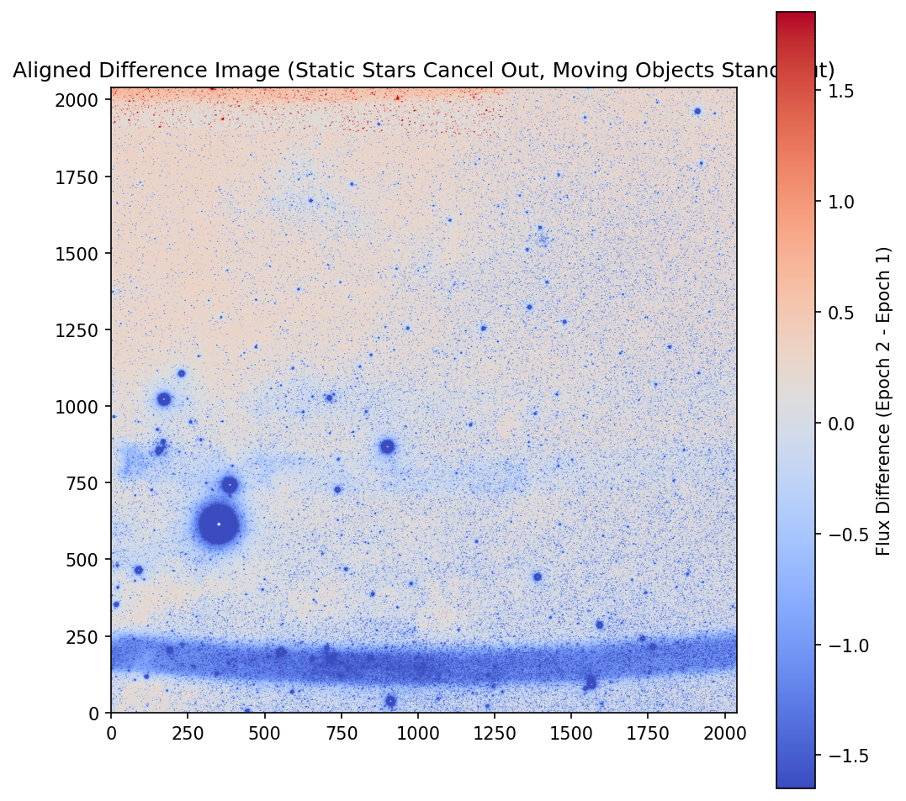

<div align="center">

<!-- Space Header Banner -->


<p align="center">
  <strong>NASA International Space Apps Challenge 2026 • Official Submission</strong>
</p>

<!-- Status & Tech Badges -->
<p align="center">
  <a href="https://spherex-explorer-2026.streamlit.app/">
    
  </a>
  <a href="https://drive.google.com/file/d/1yeZU9GpD0aRBDXzyLciH6QACtieWdK2d/view?usp=drivesdk">
    
  </a>
  <a href="https://irsa.ipac.caltech.edu/">
    
  </a>
</p>

<p align="center">
  
  
  
  
  
</p>

---

### ✨ Quick Navigation
[**Overview**](#-mission-overview) • [**Live Demo & Preview**](#-live-mission-dashboard--visual-proof) • [**System Architecture**](#-end-to-end-astrophysical-pipeline) • [**Dataset Specs**](#-verified-multi-epoch-dataset) • [**Repository Map**](#-repository-architecture) • [**Quick Start**](#-local-deployment)

</div>

<br/>

## 🌌 Mission Overview

Searching for faint, slow-moving outer solar system objects—such as Trans-Neptunian Objects (TNOs), distant comets, and hypothetical **Planet X** candidates—requires comparing infrared sky observations separated by months or years.

**SPHEREx Explorer** bridges raw space-telescope telemetry and interactive scientific discovery:
* **Automated NASA Telemetry Ingestion:** Directly queries **NASA/Caltech's Infrared Science Archive (IRSA)** via SIA2 protocols to retrieve calibrated Level-2 FITS exposures (`DR1` / `QR3`).
* **Sub-Pixel WCS Celestial Alignment:** Reprojects multi-epoch infrared frames onto a unified World Coordinate System (WCS) pixel grid so stationary background stars cancel out cleanly.
* **Interactive Difference Mapping:** Isolates residual flux anomalies (`Epoch 2 − Epoch 1`) inside a real-time web interface built for researchers and judges.

---

## 📊 Key Mission Metrics

<table>
  <tr>
    <td align="center" width="25%">
      <h3>🛰️ 407 Days</h3>
      <sub>Multi-Epoch Temporal Baseline<br/>(Apr 2025 → Jun 2026)</sub>
    </td>
    <td align="center" width="25%">
      <h3>📐 2040 × 2040</h3>
      <sub>Calibrated Detector Grid<br/>(float32 ImageHDU)</sub>
    </td>
    <td align="center" width="25%">
      <h3>🎯 Sub-Pixel</h3>
      <sub>WCS Sky Reprojection<br/>(astropy + reproject)</sub>
    </td>
    <td align="center" width="25%">
      <h3>⚡ Real-Time</h3>
      <sub>Interactive Web Explorer<br/>(Streamlit Cloud)</sub>
    </td>
  </tr>
</table>

---

## 🖥️ Live Mission Dashboard & Visual Proof

<div align="center">
  <a href="https://spherex-explorer-2026.streamlit.app/">
    
  </a>
  <br/>
  <sub><em>Figure 1: Multi-epoch WCS-aligned flux difference preview (<code>Epoch 2 − Epoch 1</code>). Stationary stars cancel out while residual infrared variations stand out.</em></sub>
</div>

<br/>

| Resource | Direct Access Link | Description |
| :--- | :--- | :--- |
| **🌐 Interactive Web App** | [**spherex-explorer-2026.streamlit.app**](https://spherex-explorer-2026.streamlit.app/) | Explore aligned observation metadata & difference imagery live in browser |
| **🎬 Video Walkthrough** | [**Watch Demo on Google Drive**](https://drive.github.com/file/d/1yeZU9GpD0aRBDXzyLciH6QACtieWdK2d/view?usp=drivesdk) | End-to-end demonstration of our pipeline, alignment, and UI |
| **📓 Colab Notebook** | [**`SPHEREx_Data_Collection.ipynb`**](./SPHEREx_Data_Collection.ipynb) | Complete reproducible Python pipeline for IRSA data querying & alignment |

---

## 🏗️ End-to-End Astrophysical Pipeline

```mermaid
flowchart LR
    A["🛰️ NASA IRSA Archive<br/>(SPHEREx DR1 / QR3)"] -->|SIA2 Query: RA, Dec, Band| B["📥 Multi-Epoch FITS<br/>(407-Day Baseline)"]
    B -->|NaN Imputation + ZScale| C["🧹 Calibrated Arrays<br/>(2040 × 2040 float32)"]
    C -->|astropy.wcs + reproject| D["🧭 WCS Sky Alignment<br/>(Unified Pixel Grid)"]
    D -->|Epoch 2 − Epoch 1| E["🔥 Residual Flux Map<br/>(Motion & Transients)"]
    E -->|Streamlit + CSV + NPY| F["🚀 SPHEREx Explorer<br/>(Live Interactive App)"]

    style A fill:#0B3D91,stroke:#60A5FA,color:#FFFFFF
    style B fill:#1E293B,stroke:#38BDF8,color:#FFFFFF
    style C fill:#1E293B,stroke:#38BDF8,color:#FFFFFF
    style D fill:#1E293B,stroke:#818CF8,color:#FFFFFF
    style E fill:#31102F,stroke:#F472B6,color:#FFFFFF
    style F fill:#7F1D1D,stroke:#F87171,color:#FFFFFF
